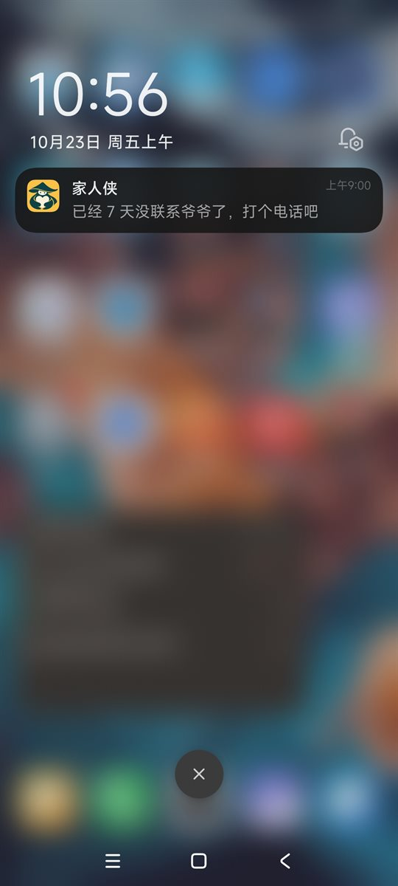
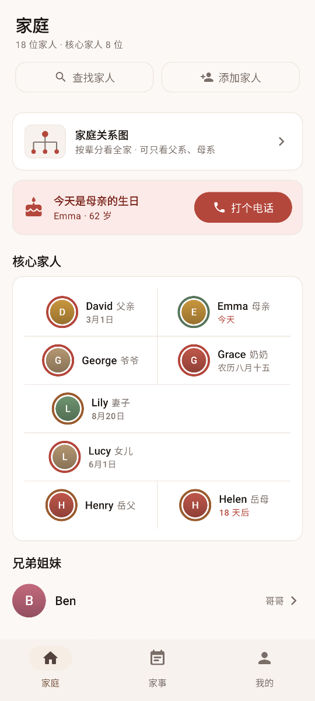
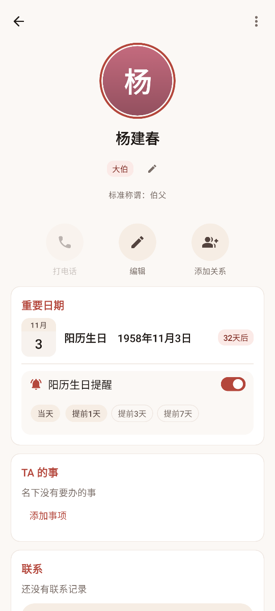
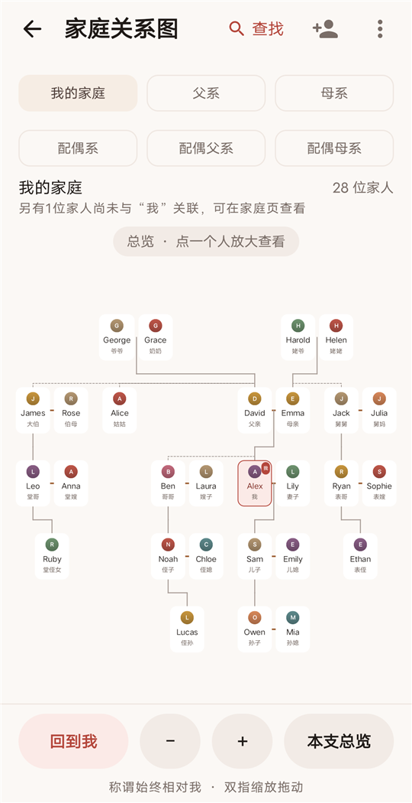
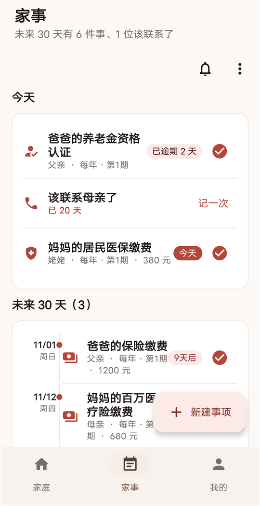
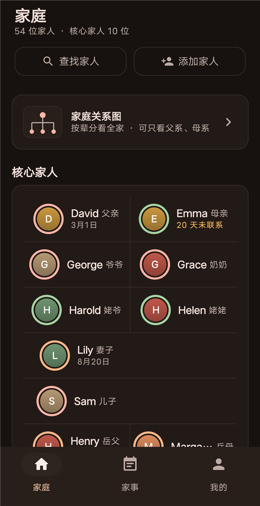

# 家人侠 JiaRenXia

源代码以 GPL-3.0 协议开源；官网：https://jiarenxia.com

> 家里的人和事，帮你记着。

家人侠是一款 Android 应用：录入家人关系，自动推导称谓；分享给家人，换成他的叫法。生日、纪念日和该打的电话到点提醒，家里的事记在一处。所有资料只保存在你自己的手机里。

请在手机空间中，给家人留一个位置。

**献给每一个有孝心的普通人。**

## 为什么做家人侠

**一、谁是谁，俺得先认全。** 俺妈打电话说"你二姑家老三要结婚了"，俺愣了半天——二姑家几个孩子？老三叫什么？过年走亲戚，一屋子人谁是谁、该叫什么，全靠俺妈在旁边小声提醒。所以先做了张关系图：全家按辈分排开，点谁就知道谁，还告诉俺"你该叫他表叔"。

**二、惦记，不能光靠记性。** 爷爷一个人住，俺总想着常打电话，可一忙就忘——等想起来，已经一个多月没打了。所以有个东西到点就提醒"该给爷爷打电话了"，打完记一笔，重新算日子。生日、纪念日、家里的事，也一样。

不要让最熟悉的家人，慢慢变成最陌生的人。

---

## 截图

### 真机实拍：每周提醒给爷爷打电话

给爷爷定了每周联系一次，到点锁屏上就会弹出提醒；打完电话记一笔，下一次重新算日子。

### 碰一碰结为夫妻（实验功能）

领证拍照的时候，两人的手机一碰，两家关系合并。两部手机并排举到镜头前，正好拼成一颗完整的心，中间是祝福语（默认“喜结连理”，可以换）。上图为场景预想效果示意（非实拍）。需要两部带 NFC 的安卓手机，尚未完成双机实测。

真机实拍：碰的时候，屏幕上双方家人的称呼和名字一个个飞进心里。图为一部手机上的“预览动画”，显示新郎这一侧的半颗心，人名为示例。

### 真机实拍：桌面插件里的“我们在一起多久”

「家事时间线」插件第一行是你和另一半在一起的天数，下面一行是结婚、领证多久；相恋、结婚、领证第 100、520、1000、1314 天等日子会提前出现在时间线里，当天按时提醒。人名为合成示例。

### 功能截图

| | | |
|---|---|---|
|  |  |  |
| 首页 | 人物详情 | 家庭关系图 |
|  |  | |
| 家事（提醒） | 深色模式 | |

功能截图为真机实拍的 2.0.0 版本界面，人物均为英文名的合成示例数据，不对应真实家庭。

---

## 功能

**认人**

- **家庭页**：“我”、核心家人（父母、祖辈、配偶、子女、配偶父母）、其他家人（按父系、母系、配偶亲属等分组），以及按姓名、称谓或拼音搜索（如输入 yjg、bofu）
- **人物资料**：头像、姓名、性别、公历或农历生日（可以不填年份，农历支持闰月）、多个手机号（可设主号码、标记停用）、备注、是否健在
- **关系管理**：父母、子女、配偶、兄弟姐妹四种基础关系，可以随时添加、删除，或修改兄弟姐妹的长幼
- **称谓推导**：根据家庭关系自动得出称谓，信息不足时只显示能确定的关系，绝不乱猜。支持堂表亲、伯母婶婶、嫂子姐夫、侄甥、孙辈，堂叔表叔等父母的堂表兄弟姐妹，伯祖父、姑奶奶、舅姥爷等祖辈的兄弟姐妹，曾祖辈与曾孙辈、亲家；配偶一方的亲戚按配偶的叫法称呼（妻子的叔叔也叫叔叔）。家里叫法不同，可以为家人设置自定义称呼（如“大伯”“外公”）
- **添加家人**：除父母、配偶、子女等核心家人外，“更多亲戚”可直接添加伯叔姑、舅舅姨妈、堂表兄弟姐妹、侄子外甥、祖辈的兄弟姐妹、父母的堂表亲、配偶的亲戚等，自动关联到对应的人
- **家庭关系图**：按辈分展示全家，支持拖动、缩放、一键横屏；可只看父系、母系、配偶方等某一支，或查找某位家人并定位；点击人物查看资料；可导出为图片分享或打印
- **家人共享**：通过微信等把家人档案发给家人，对方导入时选“我是谁”，称谓按自己的角度重新计算
- **碰一碰结为夫妻（实验功能）**：领证拍照时两部带 NFC 的安卓手机一碰，两家关系合并，屏幕上合成一颗心，祝福语可选；有彩排模式，反复演练不写入数据

**惦记**

- **生日提醒**：生日当天和前一天本地通知，可选提前 3 天、7 天，提醒时间可自定义（默认 09:00）；提醒页列出今天和未来 30 天过生日的家人
- **纪念日与忌日**：结婚、领证、恋爱纪念日（公历/农历，夫妻共同一条）、农历忌日，页头显示年龄或享年，与生日一起提前提醒
- **在一起多久**：你和另一半相恋、结婚、领证第 100、520、1000、1314 天，以及之后每满 1000 天，提前出现在家事页并按时提醒
- **联系提醒**：给每位家人定个联系周期，到点提醒“该打电话了”，打完记一笔重新算
- **桌面插件**：「家事时间线」放在手机桌面，第一行显示你和另一半在一起多久，下面是今天到未来 30 天的生日、纪念日和事项

**家事**

- **家庭事项**：缴费、医保、养老金认证、证件到期等到点提醒（可标记办结、逾期置顶），微信里也能转发给家人侠记
- **导出表格**：家事提醒可导出 CSV

**其他**

- **完全免费**：家人档案、提醒、导出表格和高清关系图等功能均可使用，没有任何付费门槛
- **快捷联系**：一键打开系统拨号界面，由你确认后再拨出
- **从通讯录选号**：编辑手机号时可直接从系统通讯录挑选，不需要读取通讯录权限
- **加密备份与恢复**：本地加密导出/导入全部数据与头像，密码由你自己保管
- **外观与大字模式**：浅色 / 深色 / 跟随系统；字体可选标准、大、特大，方便长辈使用
- **数据管理**：清空所有数据（需两次确认）

### 称谓推导示例

| 关系路径 | 结果 |
|---|---|
| 我 → 父亲 → 父亲 | 爷爷 |
| 我 → 母亲 → 母亲 | 姥姥 |
| 我 → 妻子 → 父亲 | 岳父 |
| 我 → 丈夫 → 母亲 | 婆婆 |
| 我 → 父亲 → 哥哥 | 伯父 |
| 我 → 父亲 → 兄弟（不知道长幼） | 父亲的兄弟（不猜伯父还是叔叔） |
| 我 → 父亲 → 哥哥 → 儿子 | 堂哥（按双方生日判断长幼） |
| 我 → 哥哥 → 妻子 | 嫂子 |
| 我 → 妻子 → 父亲 → 弟弟 | 叔叔（随妻子的叫法） |
| 我 → 父亲 → 父亲 → 弟弟 → 儿子 | 堂叔或堂伯（按他和父亲的生日判断；不知道时显示“父亲的堂兄弟”） |
| 我 → 父亲 → 母亲 → 兄弟 | 舅爷爷 |
| 我 → 母亲 → 父亲 | 姥爷 |

长幼优先按双方完整且不同的出生日期判断；否则使用录入关系时记录的“年长 / 年幼 / 相同”。

---

## 下载与安装

Android 正式版已发布，安装包与安装说明见官网下载页：

**https://jiarenxia.com/download**

需要 Android 8.0 及以上；也可以从源码自行构建（见下文“开发与文档”）。

---

## 隐私

- 不需要注册、登录，也没有后台服务器，家庭资料只在你的手机上
- **默认不联网**，不上传任何数据；可选开启「联网检查更新」，仅用于查询官网版本与下载安装包（SHA-256 校验后交系统安装器），随时可关
- 系统云备份不包含家人侠的数据；Android 12 及以上换机时，可以通过手机自带的设备间迁移带走数据
- 加密备份文件由你保存，应用不上传
- 卸载应用会删除全部数据
- 官网是纯静态页面，不收集信息、不使用 Cookie

详见官网 [隐私政策](https://jiarenxia.com/privacy)。

---

## 问题反馈

发送邮件至 2107290326@qq.com。

---

## 开发与文档

- 开发指南（目录、构建、工程结构）：[docs/DEVELOPMENT.md](docs/DEVELOPMENT.md)
- 协作约定（构建验证、提交、签名与发布）：[AGENTS.md](AGENTS.md)

版本更新记录见 App 内「我的 → 帮助与关于 → 更新日志」。

---

## 许可证

源码以 **GPL-3.0** 开源，许可全文见 `LICENSE`；「家人侠」「守护侠」名称、
图标与品牌素材不随源码授权，改版发布请换名换图标（见 `NOTICE.md`）。
